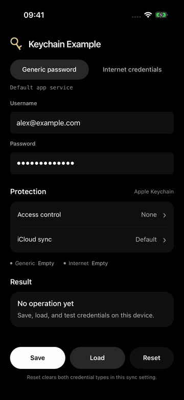
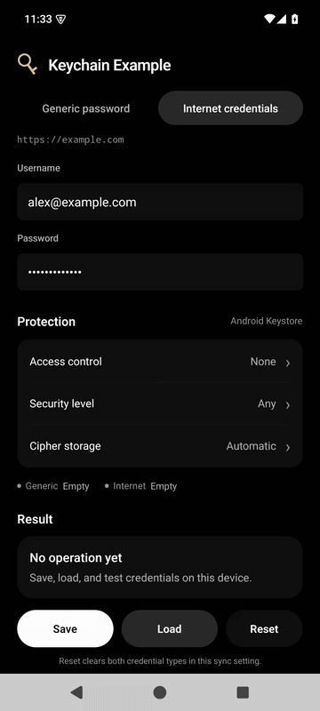

<h1 align="center"> react-native-keychain</h1>

  

This library provides access to the Keychain (iOS) and Keystore (Android) for securely storing credentials like passwords, tokens, or other sensitive information in React Native apps.

- [Installation](#installation)
- [Example app](#example-app)
- [Documentation](#documentation)
- [Changelog](#changelog)
- [Maintainers](#maintainers)
- [Used By](#used-by)
- [License](#license)

## Installation

React Native **0.82 or later** with the **New Architecture** is required for the upcoming 11.x release. Use 10.x for older React Native versions or the Old Architecture. The iOS minimum is **15.1** and Android minimum is **API 24**. Development requires **Node.js 20.19.4+**, **JDK 17**, and **Xcode 16.1+**.

1. Run `yarn add react-native-keychain`
2. Run `pod install` in `ios/` directory to install iOS dependencies.
3. If you want to support FaceID, add a `NSFaceIDUsageDescription` entry in your `Info.plist`.
4. Re-build your Android and iOS projects.

## Example app

The [example app](KeychainExample) lets you save, load, and reset generic passwords and internet credentials, choose protection options, and inspect the returned service or server and storage type. Retrieved passwords stay hidden until you reveal them.

| iOS                                                                                                                                                         | Android                                                                                                                                                  |
| ----------------------------------------------------------------------------------------------------------------------------------------------------------- | -------------------------------------------------------------------------------------------------------------------------------------------------------- |
|  |  |
| [Watch the iOS demo](KeychainExample/media/ios-demo.mp4)                                                                                                    | [Watch the Android demo](KeychainExample/media/android-demo.mp4)                                                                                         |

To run it locally, install workspace dependencies with `yarn install`. For iOS, also run `bundle install` and `bundle exec pod install --project-directory=ios` from `KeychainExample/`. Then run `yarn workspace KeychainExample ios` or `yarn workspace KeychainExample android` from the repository root.

## Documentation

Please refer to the documentation website on https://oblador.github.io/react-native-keychain

## Changelog

Check the [GitHub Releases page](https://github.com/oblador/react-native-keychain/releases).

## Maintainers

<table>
  <tbody>
    <tr>
      <td align="center">
        <a href="https://github.com/oblador">
          
           
          <strong>Joel Arvidsson</strong>
        </a>
         
        Author
      </td>
      <td align="center">
        <a href="https://github.com/DorianMazur">
          
           
          <strong>Dorian Mazur</strong>
        </a>
         
        Maintainer
      </td>
      <td align="center">
        <a href="https://github.com/vonovak">
          
           
          <strong>Vojtech Novak</strong>
        </a>
         
        Maintainer
      </td>
      <td align="center">
        <a href="https://github.com/pcoltau">
          
           
          <strong>Pelle Stenild Coltau</strong>
        </a>
         
        Maintainer
      </td>
      <td align="center">
        <a href="https://github.com/OleksandrKucherenko">
          
           
          <strong>Oleksandr Kucherenko</strong>
        </a>
         
        Contributor
      </td>
    </tr>
  <tbody>
</table>

## Used By

This library is used by several projects, including:

- [Rainbow Wallet](https://github.com/rainbow-me/rainbow)
- [MetaMask Mobile](https://github.com/MetaMask/metamask-mobile)
- [BlueWallet](https://github.com/bluewallet/bluewallet)

## License

MIT © Joel Arvidsson 2016-2020
